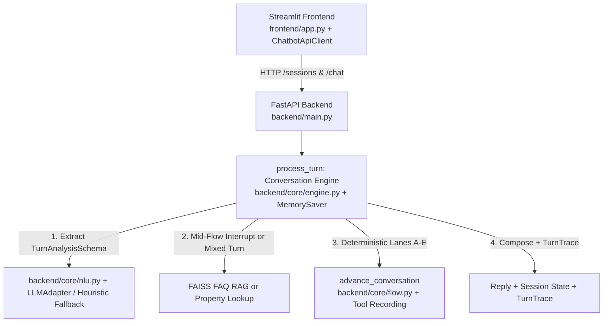

# Ashcombe & Rowe Estates — Lead Qualification Chatbot

An AI-agent-based lead qualification chatbot built with **LangGraph**, **LangChain**, and **FAISS** for Ashcombe & Rowe Estates. It follows the agency's exact conversation flowchart across buyer and seller journeys (Lanes A–E), enforces deterministic qualification rules against CSV data sources, answers mid-flow FAQ and property questions via RAG and structured lookup, and captures contact details strictly from qualified leads.

---

## Architecture Overview

The repository is separated into a **FastAPI backend** (`backend/`) and an **HTTP-only Streamlit frontend** (`frontend/`):

```text
backend/
├── main.py                # FastAPI entrypoint (`create_app`, `app`, /health, /sessions, /chat)
├── cli.py                 # Interactive CLI runner (`run_cli` + `main`)
├── core/
│   ├── config.py          # Settings & environment configuration
│   ├── validators.py      # Budget, postcode, phone, and email parsing
│   ├── knowledge_base.py  # CSV ingestion, PropertyCatalog, SellerCoverageChecker, FaqRagIndex
│   ├── llm.py             # LLMAdapter seam, LangChainLLMAdapter, embeddings, retries
│   ├── flow.py            # Deterministic A–E state machine & TurnAnalysisSchema
│   ├── nlu.py             # Turn analysis, side-Q&A grounding, deterministic fallback
│   └── engine.py          # AshcombeChatbot single-turn LangGraph engine & TurnTrace
└── scripts/
    ├── eval.py            # 10-scenario scripted evaluation harness
    └── generate_transcripts.py

frontend/
├── client.py              # Pure HTTP client (`ChatbotApiClient`, zero backend imports)
└── app.py                 # Standalone Streamlit UI talking exclusively to FastAPI over HTTP
```



> For canonical domain terms, see [`GLOSSARY.md`](GLOSSARY.md). For architectural trade-offs and decisions, see [`docs/adr/`](docs/adr/):
> - [ADR-0001: Single-Turn LangGraph Conversation Engine with Integrated Telemetry](docs/adr/0001-single-turn-langgraph-engine.md)
> - [ADR-0002: Narrow LLM Adapter Seam at the Conversation Engine Edge](docs/adr/0002-narrow-llm-adapter-seam.md)
> - [ADR-0003: Strict Backend (FastAPI) and Frontend (HTTP-Only Streamlit) Separation](docs/adr/0003-backend-frontend-http-separation.md)

### Why This Design?
- **Strict Backend / Frontend Separation (`backend/` vs `frontend/`)**: The Streamlit frontend (`frontend/app.py`) has zero imports from `backend/` and communicates strictly over HTTP via `ChatbotApiClient` (`frontend/client.py`) to the FastAPI backend (`backend/main.py`).
- **Deep Single-Turn Engine (`backend/core/engine.py`)**: A single LangGraph `process_turn` node backed by `MemorySaver` owns turn execution and `TurnTrace` telemetry, avoiding multi-node state serialization churn while recording `tools_used` right where lookups execute.
- **Unified Knowledge Base (`backend/core/knowledge_base.py`)**: Owns CSV ingestion (via stdlib `csv`), single-pass postcode normalization, property matching, seller coverage, and FAISS FAQ retrieval behind one module.
- **Narrow LLM Adapter Seam (`backend/core/llm.py`)**: `LangChainLLMAdapter` encapsulates `BaseChatModel` structured output, exponential-backoff retries (`call_with_retry`), and token-usage extraction behind `LLMAdapter`, so tests inject a lightweight `FakeLLMAdapter` without mocking LangChain internals.
- **Deterministic State Machine (`backend/core/flow.py`)**: Pure Python transitions reproduce every node (`ASK_NAME`, `BUY_OR_SELL`, `SPECIFIC_PROPERTY`, `NEW_OR_RESALE`, `A1–A6`, `B1–B5`, `C1–C6`, `D1–D2`, `E1–E3`, `M1–M3`) from `flowchart.png`, consuming `TurnAnalysisSchema` without mutating it in-place. An LLM never decides whether a visitor qualifies or whether to ask for phone/email.
- **Resilience & Heuristic Fallback (`backend/core/nlu.py`)**: If the `LLMAdapter` is omitted or fails upstream, `heuristic_analyze_turn` keeps every Journey Lane, Mixed Turn, and guardrail functional offline.

---

## Data Sources & Retrieval Strategy

| File | Purpose | Retrieval / Lookup Approach | Justification |
|---|---|---|---|
| `data/faq.csv` (47 Q&As) | Company info, branches, hours, fees, buying/selling process | **FAISS vector store + embeddings** (`FaqRagIndex`) | Visitors ask free-form, paraphrased questions (*"Are you open Sundays?"*, *"How much commission do you charge?"*). Semantic RAG over Q&A chunks handles phrasing variation while grounding answers strictly to retrieved entries (falling back to `020 7946 0100` if no match). |
| `data/properties_for_buyers.csv` (247 listings) | Buyer qualification, postcode/budget filtering, Lane C specific property lookup, property Q&A | **Deterministic in-memory tabular filtering & multi-stage name/address lookup** (`PropertyCatalog`) | Qualification requires exact numeric comparisons (`price_gbp <= budget`), exact normalized postcode matching (`SW3 3RB`), and strict status filtering (`status == "available"`, excluding `under_offer` and `sold`). Vector search alone cannot guarantee exact `<= budget` or count-based `M2` vs `M3` distinctions. |
| `data/seller_coverage.csv` (100 UK postcodes) | Seller postcode eligibility (Lane D) | **Normalized `set[str]` exact lookup** (`SellerCoverageChecker`) | Seller qualification is a binary membership check on normalized full UK postcodes (`gu5 7aq` → `GU5 7AQ`), making O(1) set lookup exact and zero-latency. |

---

## Provider & Model Configuration

All LLM and embedding settings are loaded from environment variables (`.env` / `.env.example`). **Never commit `.env` or real API keys.**

### Developed & Tested With
- **LLM Provider / Model:** `groq` / `llama-3.3-70b-versatile` (also verified against deterministic offline test suite and designed for drop-in testing with `openai` / `gemini` / `nvidia` / `openrouter` / `ollama`).
- **Embeddings:** `local` (`sentence-transformers/all-MiniLM-L6-v2`) by default with zero API key required, plus `openai` and `gemini` embeddings support via `EMBEDDING_PROVIDER`.

---

## Setup & Run Steps

### 1. Install Dependencies
```bash
python -m venv .venv
# Windows PowerShell:
.venv\Scripts\Activate.ps1
# macOS / Linux:
# source .venv/bin/activate

pip install -r requirements.txt
```

### 2. Configure Environment
```bash
cp .env.example .env
# Edit .env and set LLM_PROVIDER, LLM_MODEL, LLM_API_KEY (and EMBEDDING_* if using OpenAI/Gemini embeddings)
```

### 3. Run the FastAPI Backend + Streamlit Frontend (Recommended)
```bash
# Terminal 1: Start the FastAPI backend
uvicorn backend.main:app --host 0.0.0.0 --port 8000

# Terminal 2: Start the Streamlit frontend (talks strictly to FastAPI via BACKEND_API_URL)
BACKEND_API_URL=http://localhost:8000 streamlit run frontend/app.py
```

### 4. Run the Chatbot (CLI)
```bash
# Live LLM mode (uses .env)
python -m backend.cli --trace

# Offline deterministic mode (no API key needed)
python -m backend.cli --offline --trace
```

---

## Tests, Evaluation & Transcripts

### Run Automated Tests (`pytest`)
```bash
python -m pytest -v
```

### Run Scripted Evaluation Harness (Bonus)
```bash
# Offline deterministic evaluation across 10 scenarios
python -m backend.scripts.eval

# Live LLM evaluation using .env
python -m backend.scripts.eval --llm
```

### Sample Transcripts
See `transcripts/` for verified conversations covering Lanes A, B, C, and D, including mid-flow FAQ interruption:
- `transcripts/lane_a_new_build_with_faq.md`
- `transcripts/lane_b_resale_qualified.md`
- `transcripts/lane_c_specific_property_sold.md`
- `transcripts/lane_d_seller.md`

---

## Key Design Decisions, Trade-offs & Assumptions

1. **Hybrid Deterministic Flow + LLM NLU vs. Pure Tool-Calling Agent:**
   - *Trade-off:* A single autonomous ReAct loop is simpler to write initially, but frequently drifts on multi-branch state machines (e.g., asking phone/email before checking `M2`/`M3`, re-asking budget after Lane C `C5`, or failing to resume the exact prior step after an FAQ). Separating `LLMAdapter` NLU extraction from `advance_conversation` (pure Python state machine) guarantees 100% flowchart compliance and unit-testability.
2. **Multi-Slot Progression Within a Single Turn:**
   - Visitors naturally pack multiple facts into one message (*"Hi, I'm Sam and I want to look at Rosemount House"*). The flow engine loops cleanly across satisfied steps in one turn while still executing every validation and qualification gate in exact order.
3. **Assumptions:**
   - Budget strings below £10,000 without a `k`/`m` suffix (e.g. `"3 bedrooms"`) are ignored as budgets to avoid false positives.
   - Phone validation accepts UK (`0...`, `+44...`) and international numbers (`+...`) with 10–15 digits.
   - Reassist (`E3 -> yes`) preserves `visitor_name`, `phone`, and `email` as required by the flowchart; if the visitor qualifies a second time in the same session, the bot confirms the kept contact details at `E3` rather than re-asking them.
4. **Known Limitations:**
   - `MemorySaver` stores session state in-memory per process; multi-worker production deployments require a persistent checkpointer (e.g. Postgres/Redis).
   - Property name matching uses normalized substring/token matching rather than phonetic fuzzy matching (`rapidfuzz`), so severe typos may trigger the `C1` retry prompt.

---

## Production Hardening

### Risks Identified for a Customer-Facing Real Estate Chatbot
1. **Prompt Injection & Policy Bypass:** Visitors attempting to override the £1M new-build minimum, extract system prompts, or fabricate discounts/availability.
2. **Hallucinated Listings, Prices, or Legal/Tax Advice:** LLMs inventing property features, branch hours, or stamp-duty advice (explicitly prohibited in `faq.csv` FAQ-045).
3. **PII Exposure & UK GDPR Compliance:** Storing or logging visitor names, phone numbers, and emails in plain-text logs or LLM trace payloads without retention/deletion controls (see FAQ-046).
4. **Provider Outages & Rate Limits:** Upstream LLM 429s or timeouts causing broken mid-funnel conversations and lost leads.
5. **DoS / Abuse & Session Hijacking:** Unauthenticated endpoints receiving huge payloads, automated spam, or guessing sequential `session_id`s.

### What Was Handled in This Implementation
- **Policy Isolation:** Business rules (`£1M` floor, `available`-only filter, `seller_coverage.csv` gate, no contact capture on `M1/M2/M3`) live purely in deterministic Python—completely unreachable by prompt injection. Explicit override patterns are blocked before NLU.
- **Strict Grounding:** FAQ and property answers are synthesized only from retrieved CSV rows with a hard fallback to `020 7946 0100`.
- **Resilience:** Exponential backoff retries (`call_with_retry`) plus deterministic heuristic NLU fallback so provider blips don't drop a lead mid-conversation.
- **Input Validation:** Strict regex/format checks on budgets, UK postcodes, phones, and emails; unguessable UUID session IDs.

### What Would Be Added With More Time
- **Persistent Checkpointer & CRM Webhook:** PostgreSQL-backed LangGraph checkpointer (`langgraph-checkpoint-postgres`) and an idempotent CRM handoff queue (e.g., HubSpot/Salesforce) triggered only when `qualified == True` and `E2` completes.
- **PII Redaction & GDPR Lifecycle:** Mask phone/email before sending to external LLM observability tools (Langfuse/LangSmith) and implement automated retention/deletion endpoints (`privacy@ashcombe-rowe.example`).
- **Rate Limiting, Auth & Moderation:** Per-IP/session token-bucket rate limiting on FastAPI (`slowapi`), input length caps, and WAF/bot protection.
- **Live Inventory Sync:** Scheduled sync or database-backed repository instead of static CSVs so `under_offer`/`sold` transitions reflect real-time negotiator updates.
